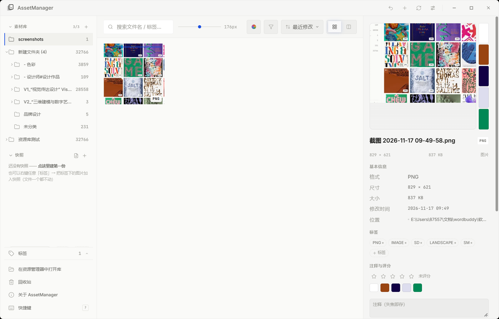

<div align="center">


# AssetManager

**素材库只记索引，不搬你的文件 —— 拖出去、复制、打开的永远是磁盘上那一份。**

百万级素材库里滚得动、看得清、找得到：多格式缩略图、标签与分组、快照、无限灵感板、截图标注。

<br>

[](LICENSE)
[](../../releases)
[](#平台与构建)
[](https://tauri.app)
[-blue?style=flat-square)](#已知限制)

<br>

**[⬇ 下载最新安装包](../../releases/latest)** ·
**[🔧 从源码构建](#平台与构建)** ·
**[🐛 反馈问题](../../issues)**

<br>



<sub>左侧：素材库目录树 · 快照 · 标签；中间：缩略图网格；右侧：详情、评分、注释。</sub>

</div>

<br>

---

## 这是什么

一个 **Windows 桌面素材管理器**，核心是一条约定：

> **索引，不搬家。** 你的原图待在它原来的文件夹里。软件只记住"它在哪、多大、什么格式、属于哪些标签"，
> 拖到 Photoshop、复制、在资源管理器打开、另存 —— 全部作用于**磁盘上的原文件**。
> 缩略图只是用来看的，永远不会被当成结果交出去。

技术上：**Tauri v2 + React + TypeScript**（界面） + **Rust**（扫描、缩略图、SQLite 索引、系统集成）。
索引落在本地 SQLite，一个素材库对应一个索引；多库各自独立、互不干扰。

## 主要能力

| 能力 | 说明 |
|---|---|
| **多素材库** | 最多 3 个库根；每库的标签/分组/评分**存在库自己的 `.AssetManager/` 里**，跟着文件夹走 —— 换机、挪盘、移除后重新导入都不丢，也不会串库 |
| **多格式缩略图** | JPG/PNG/WebP/AVIF/HEIC、PSD/PSB、AI/EPS、SVG/WMF/EMF、各厂 RAW、PDF —— 统一走一条缩略图管线（内嵌预览优先，取不到再用系统缩略图），失败不报错、留占位 |
| **滚动性能** | 视口外不挂 ``（不挂就不解码）；百万元素靠 keyset 分页，滚多快都不抖 |
| **标签 / 分组** | 手工标签 + 自动标签（格式、类型、尺寸、色彩等从文件事实推导，只读）；标签分组、颜色、批量打标 |
| **快照** | 把一批图"记下来"（不搬文件）。身份是**文件内容指纹**（xxh3-128），所以**改名、换目录、换素材库之后导回来照样对得上**；右键可**只看这份快照**（主列表据此筛选）、两份快照可合并（并集）/ 差集；可导出清单 `.json`、可把原图打包 `.zip` |
| **灵感板** | 任意标签 / 任意快照右键 → 一块**无限、无边界**的画布：任意拖动、滚轮缩放、单张改大小，**位置与大小会记住**（下次开板还原）；板上复制 / 打开 / 定位一律作用原文件；板内 `Ctrl+V` 把剪贴板图存进 `screenshots` 并自动打标 |
| **截图标注** | `F1` 选区 → 矩形/椭圆/箭头/画笔/文字/马赛克（可拖动/删除单条）+ 撤销重做 → `Ctrl+C` 复制 / `Ctrl+S` 保存（或点工具栏按钮）；`F3` 贴图板 |
| **工具面板** | 重复文件、丢失引用、批量重命名 |
| **命令面板** | `Ctrl+K` 找命令、跳转、新建快照、导入快照 |

## 快捷键

| 键 | 作用 |
|---|---|
| `F1` | 选区截图（松手进标注态，**不会自动复制、不会自动关闭**） |
| `F3` | 贴图板（剪贴板贴图 / 多开 / 重启还原） |
| `Ctrl+K` | 命令面板 |
| `Space` | 预览当前素材 |
| `Ctrl+C` / `Ctrl+V` | 复制原文件 / 在灵感板里粘贴入库 |
| 灵感板：拖空白 / 滚轮 / `F` / `0` / `Esc` | 平移 / 缩放 / 适应窗口 / 100% / 关闭 |

## 平台与构建

Windows 10/11 x64。需要 Rust 工具链 + Node 20+ + WebView2（Win11 自带）。

```bash
# 依赖
cd AssetManager/app && npm install

# 开发（dev 端口 1430）
cd .. && ./app/node_modules/.bin/tauri dev

# 打包（产出 src-tauri/target/release/bundle/nsis/AssetManager_<ver>_x64-setup.exe）
./app/node_modules/.bin/tauri build
```

## 0.2.3 更新了什么

- **修「截图开始时黑一下」**：冻结画面现在从按下 `F1` 的下一帧就铺满屏幕，工具栏在覆盖层真正
  画好之后才揭幕——中间那段"窗口还没画出内容"的空档被原生底图整段盖住了（逐帧验证 0 黑帧）。
- **侧栏改为切换视图**：点「分组 / 标签 / 快照」是切换到那个视图，不再是往当前结果上叠筛选；
  叠加筛选只留在漏斗面板里做。点同一项再点一次退出该视图。
- **修「点截图没反应」**：之前挂着的快照筛选没被清掉，会让结果变成 0 条。
- 顶栏「添加素材文件夹」换成了文件夹图标；无边框贴图的蓝边/光晕收窄（20px→10px，阴影不再是三层）。

## 0.2.1 更新了什么

- **设置面板补齐**：素材库不再只能从侧栏那个不起眼的 `+` 添加，设置 → 素材库可以直接看路径、
  看每个库有多少素材、打开、移除；内置截图库单独一行（不占 3 个名额、不能移除）。
- **自动更新**：设置 → 更新，可查看当前版本、手动检查、**一键下载并静默安装**（校验 SHA-256，
  只给按用户安装的 NSIS 版用）。默认每天最多自动查一次，只提醒，不会偷偷装；也可以跳过某个版本。
- **修「打开位置不对」**：点详情里的「位置」现在会打开文件所在目录并选中它；
  点素材库那行的「打开」会**进入**那个文件夹。目标文件被移走时会明确告诉你，而不是跳到「文档」。
- 关于页补了项目主页、问题反馈、许可证入口。

> 更新链路需要能访问 GitHub（api.github.com / github.com）。网络不通时检查会静默跳过，
> 不会弹错误；需要用代理时，让系统代理对 `assetmanager.exe` 生效即可。

## 已知限制

- **0.2.1 是第一个对外正式版**，但版本号仍是 0.x：数据结构还可能动，不建议当唯一存档；
- 只支持 Windows。

## 与 FontManager 的关系

同一台机器上的另一个项目是 [FontManager](https://github.com/706972745/FontManager)（字体管理器）。
两者**互不依赖**：各自的仓库、版本号、安装包、数据目录、端口（AssetManager `1430`）。
只共用便携工具链与视觉语汇 —— 侧栏、动效、标签面板、快照段的形态刻意保持一致，用起来是同一套手感。

## 许可

**GNU General Public License v3.0**（GPL-3.0）· 全文见 [`LICENSE`](LICENSE)。

Copyright (C) 2026 AssetManager authors

简单说：可以自由使用、修改、分发，甚至商用；但**分发时必须一并提供源码**，
且衍生作品必须同样以 GPL-3.0 发布。想把它并进闭源产品是不行的。
（如果你只想在自己机器上用，这些义务与你无关。）
